<a href="https://github.com/BurgiSimon/simon"></a>

  <a href="https://github.com/ktsobus"><picture><source media="(prefers-color-scheme: dark)" srcset="assets/pill-work-dark.svg"></picture></a>
  <a href="https://modrinth.com/mod/playerscale"><picture><source media="(prefers-color-scheme: dark)" srcset="assets/pill-modrinth-dark.svg"></picture></a>
  <a href="https://ko-fi.com/chliburgi"><picture><source media="(prefers-color-scheme: dark)" srcset="assets/pill-kofi-dark.svg"></picture></a>

 

<picture><source media="(prefers-color-scheme: dark)" srcset="assets/heading-about-dark.svg">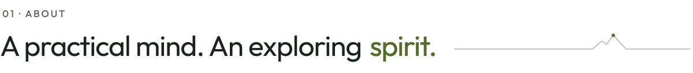</picture>


From a four-year Swiss apprenticeship in application development to business informatics in the Canton of Solothurn. I’m interested in the whole path from an idea to something useful: the interface, the logic behind it, and how it all fits together.

- 💼 **Wirtschaftsinformatiker** at the Amt für Informatik und Organisation, Kanton Solothurn
- 🎓 Swiss **EFZ** in application development, four-year apprenticeship
- 🔌 Frontend, backend, electronics and AI: I like getting my hands on things and finding out how they work
- 🐧 Personal projects live here, work happens at [@ktsobus](https://github.com/ktsobus)

 

<picture><source media="(prefers-color-scheme: dark)" srcset="assets/heading-toolkit-dark.svg">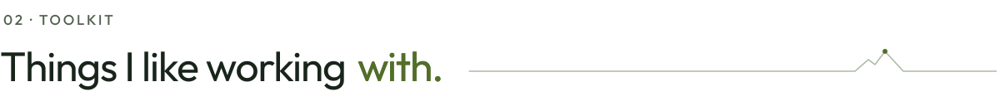</picture>

<picture><source media="(prefers-color-scheme: dark)" srcset="assets/toolkit-dark.svg">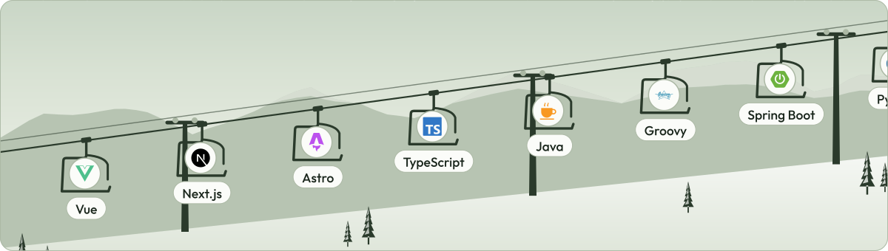</picture>

  

<picture><source media="(prefers-color-scheme: dark)" srcset="assets/heading-work-dark.svg">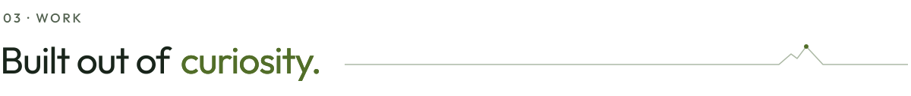</picture>

Personal projects. Open code. A few things I wanted to exist.

  <a href="https://github.com/BurgiSimon/triolFM"><picture><source media="(prefers-color-scheme: dark)" srcset="assets/card-triolfm-dark.svg"></picture></a>
  <a href="https://github.com/BurgiSimon/PlayerScale"><picture><source media="(prefers-color-scheme: dark)" srcset="assets/card-playerscale-dark.svg"></picture></a>
  <a href="https://github.com/BurgiSimon/UXL"><picture><source media="(prefers-color-scheme: dark)" srcset="assets/card-uxl-dark.svg"></picture></a>
  <a href="https://github.com/BurgiSimon/awards"><picture><source media="(prefers-color-scheme: dark)" srcset="assets/card-awards-dark.svg"></picture></a>
  <a href="https://github.com/BurgiSimon/spoter"><picture><source media="(prefers-color-scheme: dark)" srcset="assets/card-spoter-dark.svg"></picture></a>
  <a href="https://github.com/BurgiSimon/Shred360"><picture><source media="(prefers-color-scheme: dark)" srcset="assets/card-shred360-dark.svg">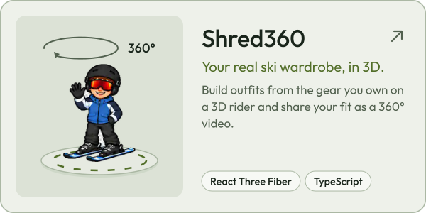</picture></a>

 

<picture><source media="(prefers-color-scheme: dark)" srcset="assets/heading-stats-dark.svg">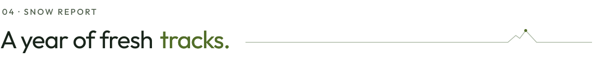</picture>

<picture><source media="(prefers-color-scheme: dark)" srcset="assets/snow-report-dark.svg">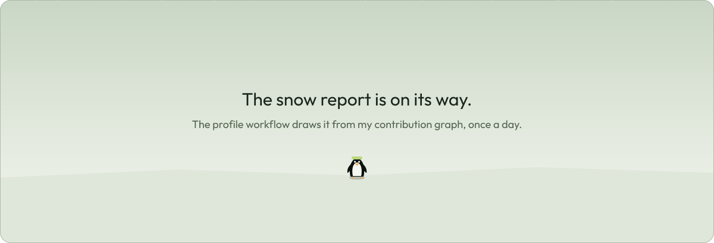</picture>

Every summit is one week of contributions. A workflow in this repo redraws it daily from the GitHub API.

  

<picture><source media="(prefers-color-scheme: dark)" srcset="assets/heading-beyond-dark.svg">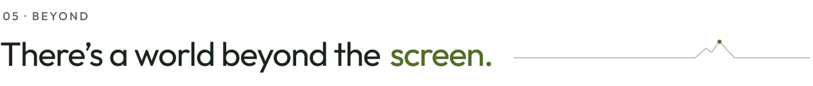</picture>

<picture><source media="(prefers-color-scheme: dark)" srcset="assets/beyond-dark.svg"></picture>

Fresh air, a good tune, and good company. On skis in winter, on a hiking trail when the snow clears. A game of football, music in my ears, or a trumpet in my hands. And whenever possible, time with friends: curiosity is better shared.

 

  

Merci fürs Vorbeischauen · thanks for stopping by

